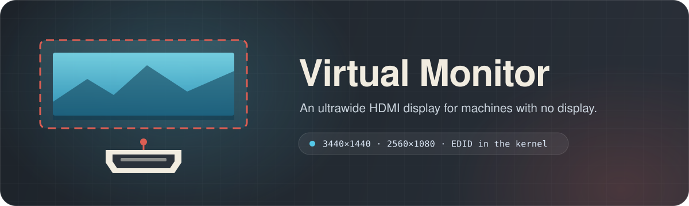
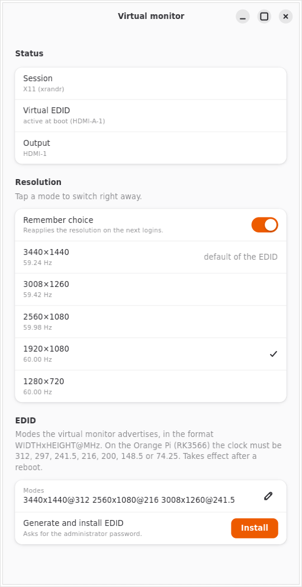

<div align="center">

<sub><a href="README.md">🇧🇷 Português</a> · <b>🇺🇸 English</b></sub>



<br>

<p>
  
  
  
  <a href="https://gitlab.com/danie1net0/virtual-hdmi/-/pipelines"></a>
  <a href="https://gitlab.com/danie1net0/virtual-hdmi/-/pipelines"></a>
  <a href="LICENSE"></a>
</p>

**A virtual EDID in the kernel and an app to switch the resolution — with no monitor plugged in.**<br>
<sub>Nothing beyond the Python standard library; the app uses GTK 4 and libadwaita.</sub>

<p>
  <a href="#-quick-install"><b>Install</b></a> ·
  <a href="#-use">Use</a> ·
  <a href="#-edid">EDID</a> ·
  <a href="#-light-session-without-a-display">Light session</a> ·
  <a href="#-supported-environments">Environments</a> ·
  <a href="#-develop">Develop</a> ·
  <a href="#-verify">Verify</a>
</p>

<br>



</div>

<br>

## ✨ Highlights

<table>
  <tr>
    <td width="33%" valign="top">
      <h3>🖥️ A screen without a screen</h3>
      An EDID installed in the kernel makes the HDMI output offer <b>3440×1440</b>, <b>3008×1260</b> and <b>2560×1080</b> with no physical monitor.
    </td>
    <td width="33%" valign="top">
      <h3>🔁 Switch on the spot</h3>
      Pick the mode in the window or from the terminal. Works on <b>GNOME, KDE, wlroots and X11</b>.
    </td>
    <td width="33%" valign="top">
      <h3>💾 Remembers your choice</h3>
      The resolution comes back by itself at every login, even on environments that do not keep the setting.
    </td>
  </tr>
  <tr>
    <td width="33%" valign="top">
      <h3>🧮 Tailor-made EDID</h3>
      Generate a new EDID with the right pixel clocks. The <b>RK3566</b> HDMI rejects the ones its PLL cannot generate exactly.
    </td>
    <td width="33%" valign="top">
      <h3>🪶 Light session</h3>
      Scripts to swap GNOME for <b>XFCE + LightDM</b> with auto-login and keep the session active.
    </td>
    <td width="33%" valign="top">
      <h3>🧪 Reliable</h3>
      <b>100%</b> line and branch coverage in Python, and line coverage in the shell scripts.
    </td>
  </tr>
</table>

> [!NOTE]
> **Why does it exist?** Headless machines (an Orange Pi, a server, a laptop with the lid closed)
> often hand a small screen — or none — to remote desktop tools such as Jump Desktop, VNC or RDP.
> With a virtual EDID, the system believes a monitor is plugged in, with the resolutions you define.

## 🚀 Quick install

In the project folder, **without `sudo`**:

```sh
bash install.sh
```

The installer checks the environment, copies the app to `~/.local/share/virtual-monitor`,
installs the icon and creates the **Virtual monitor** menu launcher. Only the EDID install
(inside the app) asks for the administrator password.

### Requirements

| | Requirement | What for |
|:-:| --- | --- |
| 🐧 | Linux with **GNOME, KDE, wlroots or X11** | Switching the resolution of the current session. |
| 🐍 | **Python 3.10+** | Running the app and the EDID generator. |
| 🪟 | **GTK 4 and libadwaita** for Python | The window and the GNOME backend. |
| 🔐 | **`pkexec`** <sub>optional</sub> | The button that installs the EDID asks for the password through it. |

On Debian, Ubuntu and Armbian:

```sh
sudo apt install python3-gi gir1.2-gtk-4.0 gir1.2-adw-1
```

Missing dependencies are reported before anything is installed.

### Installer options

| Option | Effect |
| --- | --- |
| `--dev` | Links to this folder, for development. |
| `--dest-dir PATH` | Installs into another data folder, without updating caches or the autostart. |
| `--skip-check` | Does not check the app dependencies. |
| `--uninstall` | Removes the app, icon, launcher and the resolution autostart. |
| `--help` | Shows the help. |

<details>
<summary><b>📁 Install location and migration</b></summary>

<br>

The install uses `$XDG_DATA_HOME` when it is an absolute path, or `~/.local/share`.

| Item | Path |
| --- | --- |
| App | `virtual-monitor/` |
| Launcher | `applications/virtual-monitor.desktop` |
| Icon | `icons/hicolor/512x512/apps/virtual-monitor.png` |
| Remembered resolution | `~/.config/virtual-monitor/mode.json` |
| Resolution autostart | `~/.config/autostart/virtual-monitor-restore.desktop` |

Anyone with the old version, which used Portuguese names (`monitor-virtual`), is migrated
on install: the saved resolution is copied, the new autostart is created, and the old app,
icon and launcher are removed. `--uninstall` keeps the remembered resolution.

</details>

## 🖱️ Use

Open **Virtual monitor** from the menu or run `python3 virtual-monitor.py`.

| In the window | What happens |
| --- | --- |
| **Status** | Shows the detected session, whether the virtual EDID is active at this boot, and the output in use. |
| **Resolution** | Tap a mode to switch right away; the current one is checked. |
| **Remember choice** | Reapplies the resolution at the next logins. |
| **EDID** | Generates a new EDID from the modes you type and installs it, asking for the password. |

### From the terminal

```sh
python3 virtual-monitor.py --list                  # session, connector and modes
python3 virtual-monitor.py --apply 2560x1080@59.98 # applies and remembers at the next login
python3 virtual-monitor.py --apply 1920x1080@60.00 --temp   # applies without remembering
python3 virtual-monitor.py --restore               # reapplies the last remembered mode
```

```text
session: X11 (xrandr)
connector: HDMI-1  (EDID at boot: HDMI-A-1)
 + 3440x1440@59.24  3440x1440  59.240 Hz
   2560x1080@59.98  2560x1080  59.980 Hz
*  1920x1080@60.00  1920x1080  60.000 Hz
```

`*` is the current mode and `+` the EDID's preferred one. The terminal mode shares the
window's code and never opens GTK.

## 🔬 EDID

The EDID is the monitor's "business card": the list of resolutions it accepts. Installed in
the kernel (`drm.edid_firmware`), it makes the HDMI-A-1 output look like a real monitor.

```sh
sudo bash scripts/install-edid.sh edid/ultrawide-rockchip.bin   # Orange Pi (RK3566)
sudo bash scripts/install-edid.sh                               # Intel laptop (edid/ultrawide.bin)
```

The script copies the EDID, adds the file to the boot image, checks that it got in, and
only then adjusts the kernel parameters — in `/boot/armbianEnv.txt` (Armbian) or in GRUB.
Before touching anything it keeps a `*.before-edid` copy; to undo, restore it and reboot.

### Generate a new EDID

```sh
python3 -m virtual_monitor.edid output.bin 3440x1440@312 2560x1080@216:60 --vic 16 --vic 4
```

Each mode is `WIDTHxHEIGHT@CLOCK_MHZ[:TARGET_HZ]`; `--vic` adds standard CEA modes.
The clock matters: the Rockchip HDMI rejects with `NOCLOCK` every mode whose clock the PLL
cannot generate exactly.

Clocks (MHz) the RK3566 PLL generates exactly: `312`, `297`, `241.5`, `216`, `200`,
`148.5` and `74.25`. `edid/ultrawide-rockchip.bin` uses only these.

<details>
<summary><b>📐 How the generator computes the timings</b></summary>

<br>

The generator uses reduced blanking, CVT style. For the chosen clock it sets `htotal` and
`vtotal` to land near the target rate (60 Hz by default) without creating a huge vertical
blanking. The result is a 256-byte EDID: the base block, with the first three modes, and the
CTA-861 extension, with the extra modes, the VICs and the HDMI block (340 MHz max TMDS).

Modes outside the descriptor limits (12 bits per measure, clock up to 655.35 MHz),
non-ASCII names and EDIDs that do not fit in 256 bytes are rejected with a clear message.

</details>

## 🪶 Light session without a display

For a machine that only serves as a server, GNOME is heavy. Two scripts help:

```sh
sudo bash scripts/install-xfce.sh [user]   # XFCE + LightDM with auto-login
sudo bash scripts/install-session.sh       # keeps the auto-login session active
```

- `install-xfce.sh` installs XFCE, LightDM and the X server, sets up auto-login and swaps the
  login manager. GNOME stays installed; nothing is restarted. To go back:
  `sudo systemctl enable gdm3.service && sudo reboot`.
- `install-session.sh` creates the `keep-session` service. If GDM opens the login screen on
  top of the auto-login session, it gives the seat back to the user's session — without it, the
  remote desktop captures the login screen. Log: `journalctl -u keep-session`.

## 🧭 Supported environments

| Environment | Backend | Note |
| --- | --- | --- |
| **GNOME** (Mutter) | DBus `org.gnome.Mutter.DisplayConfig` | GNOME itself keeps the choice. |
| **KDE Plasma** | `kscreen-doctor` | Remembered through the app's autostart. |
| **wlroots** (sway, labwc, Hyprland) | `wlr-randr` | Remembered through the app's autostart. |
| **X11** (XFCE, MATE, i3) | `xrandr` | Remembered through the app's autostart. |

The app picks the backend by itself. If the virtual EDID's output is on the kernel command
line, it uses that one; otherwise it uses the first connected output.

## 🛠️ Develop

```sh
bash install.sh --dev   # installs links to this checkout
```

<details>
<summary><b>🗂️ Code layout</b></summary>

<br>

| Path | Responsibility |
| --- | --- |
| [`virtual-monitor.py`](virtual-monitor.py) | Entry point: window with no arguments, terminal with options. |
| [`virtual_monitor/edid.py`](virtual_monitor/edid.py) | EDID generator: timings, descriptors, blocks and checksums. |
| [`virtual_monitor/displays.py`](virtual_monitor/displays.py) | Environment detection and the Mutter, KScreen, wlr-randr and xrandr backends. |
| [`virtual_monitor/choice.py`](virtual_monitor/choice.py) | Remembered resolution and autostart. |
| [`virtual_monitor/cli.py`](virtual_monitor/cli.py) · [`window.py`](virtual_monitor/window.py) | Terminal mode and the GTK window. |
| [`scripts/`](scripts/) | System scripts (root); all accept `ROOT=` for tests. |
| [`edid/`](edid/) | Ready-made EDIDs for Rockchip and Intel. |
| [`install.sh`](install.sh) · [`data/`](data/) · [`assets/`](assets/) | Installer, launcher and icon. |
| [`tests/`](tests/) | Python and shell tests, with the system simulated. |

</details>

Project rules: standard library only (plus `gi` in the window), everything in English, and
scripts that run on macOS bash 3.2 and Linux bash 5 — no `sed -i`, `install -D` or
associative arrays.

## ✅ Verify

```sh
bash tests/run.sh
```

| Command | Check |
| --- | --- |
| `bash tests/run.sh` | Python (`unittest`) and shell tests. |
| `bash tests/coverage.sh` | Coverage: `coverage.py` with lines and branches, and xtrace for the shell scripts. |

The Python tests use a fake GTK (`tests/fake_gi.py`), and the shell tests swap `apt`,
`systemctl`, `loginctl` and others for stubs that record every call. Coverage requires
**100%**; the shell part needs bash 4.1+ and a non-root user — on macOS, use the container
described in the header of [`tests/coverage.sh`](tests/coverage.sh).

[GitLab CI](.gitlab-ci.yml) runs the tests on Python 3.10 and 3.13 and measures coverage on
every push and merge request.

## 📄 License

Released under the [MIT license](LICENSE). Use, modify and redistribute freely.

The main repository lives on [GitLab](https://gitlab.com/danie1net0/virtual-hdmi);
[GitHub](https://github.com/danie1net0/virtual-hdmi) is an automatic replica.
Issues and merge requests are welcome on GitLab.
