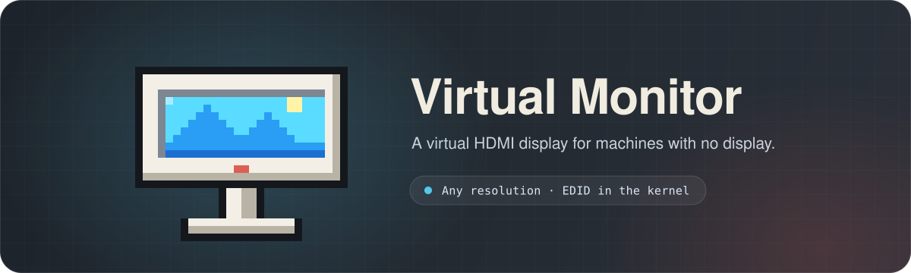
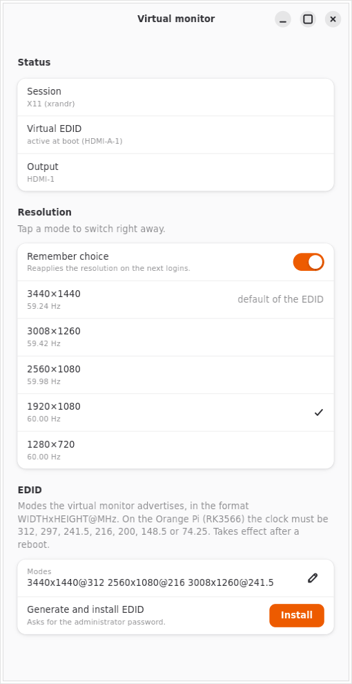

<div align="center">



<br>

<p>
  
  <a href="https://gitlab.com/danie1net0/virtual-hdmi/-/pipelines"></a>
  <a href="https://gitlab.com/danie1net0/virtual-hdmi/-/pipelines"></a>
  <a href="LICENSE"></a>
</p>

<sub><b>🇺🇸 English</b> · <a href="README.pt-BR.md">🇧🇷 Português</a></sub>

<br>



</div>

## Why

Headless machines (an Orange Pi, a server, a laptop with the lid closed) give remote desktop
tools such as VNC, RDP or Jump Desktop a small screen, or none. Virtual Monitor installs an EDID
in the kernel, so the HDMI output acts like a real monitor with the resolutions you choose. A
small app then switches between them and remembers your choice. The Orange Pi EDID also has
the iPad Air 11" screen (2360×1640), so Jump Desktop's Fluid protocol can match it when you
connect from the tablet.

## Install

```sh
sudo apt install python3-gi gir1.2-gtk-4.0 gir1.2-adw-1   # Debian, Ubuntu, Armbian
curl -fsSL https://gitlab.com/danie1net0/virtual-hdmi/-/raw/master/get.sh | bash
```

This adds **Virtual monitor** to the app menu, without sudo. Run the same line to update; add
`-s -- --uninstall` after `bash` to remove it. From a clone, `bash install.sh` does the same
(`--help` lists the options).

## Use

Open **Virtual monitor** from the menu, or use the terminal:

```sh
python3 virtual-monitor.py --list                    # outputs and modes
python3 virtual-monitor.py --apply 2560x1080@59.98   # switch and remember
python3 virtual-monitor.py --apply 1920x1080@60.00 --temp   # switch only
```

Works on GNOME, KDE Plasma, wlroots (sway, Hyprland) and X11 (XFCE, MATE, i3).

## Install the EDID

Once per machine. The app has an **Install** button (tap the **Virtual EDID** row), or, from a clone:

```sh
sudo bash scripts/install-edid.sh edid/ultrawide-rockchip.bin   # Orange Pi (RK3566)
sudo bash scripts/install-edid.sh                               # Intel laptop
```

The script edits `armbianEnv.txt` or GRUB and keeps a `*.before-edid` backup. Reboot after.

<details>
<summary><b>Make your own EDID</b></summary>

<br>

```sh
python3 -m virtual_monitor.edid output.bin 3440x1440@312 2560x1600 1920x1200:50 --vic 16
```

Each mode is `WIDTHxHEIGHT[@CLOCK_MHZ][:TARGET_HZ]`; `--vic` adds standard CEA modes. The app's
**Modes** field takes the same format.

On the RK3566, use only clocks its PLL can generate exactly (`312`, `297`, `241.5`, `216`,
`200`, `148.5`, `74.25` MHz). Others fail with `NOCLOCK`. A mode without a clock gets the one
closest to the rate.

</details>

<details>
<summary><b>Lighter session for a headless server</b></summary>

<br>

```sh
sudo bash scripts/install-xfce.sh [user]   # XFCE + LightDM with auto-login
sudo bash scripts/install-session.sh       # stop GDM from taking the seat back
```

GNOME stays installed. To go back: `sudo systemctl enable gdm3.service && sudo reboot`.

</details>

## Develop

```sh
bash install.sh --dev     # links the app to this checkout
bash tests/run.sh         # all tests
bash tests/coverage.sh    # 100% required (see the script header on macOS)
```

Standard library only. CI runs the tests on Python 3.9 and 3.13 and on macOS bash 3.2.
See [AGENTS.md](AGENTS.md) for the code layout and rules.

## License

[MIT](LICENSE). Main repository on [GitLab](https://gitlab.com/danie1net0/virtual-hdmi);
[GitHub](https://github.com/danie1net0/virtual-hdmi) is a mirror.
