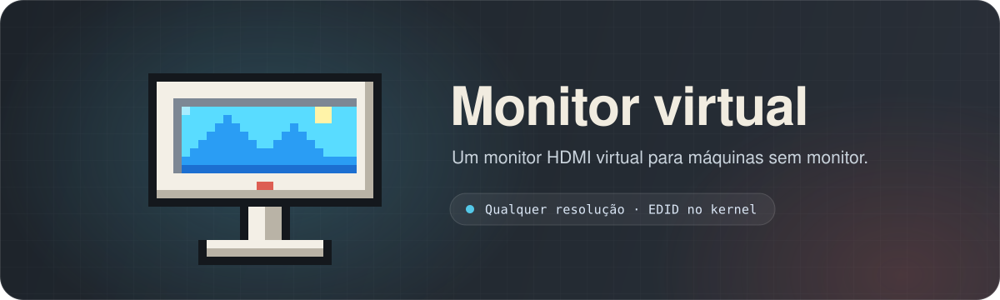
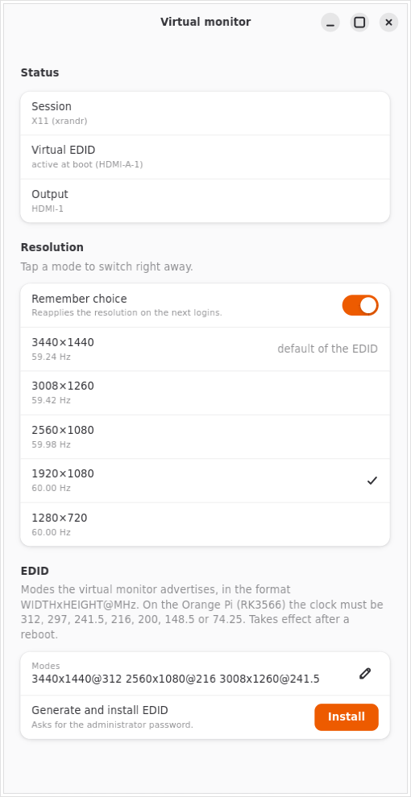

<div align="center">



<br>

<p>
  
  <a href="https://gitlab.com/danie1net0/virtual-hdmi/-/pipelines"></a>
  <a href="https://gitlab.com/danie1net0/virtual-hdmi/-/pipelines"></a>
  <a href="LICENSE"></a>
</p>

<sub><a href="README.md">🇺🇸 English</a> · <b>🇧🇷 Português</b></sub>

<br>



</div>

## Por quê

Uma máquina sem monitor ligado, como um mini PC, um computador de placa única (Raspberry Pi,
Orange Pi), um desktop ou servidor guardado num canto ou um notebook de tampa fechada, entrega às
ferramentas de área de trabalho remota, como VNC, RDP ou Jump Desktop, uma tela pequena, ou
nenhuma. O Monitor virtual faz uma saída de vídeo livre agir como um monitor de verdade, com as
resoluções que você escolher. Um app pequeno troca entre elas e lembra a sua escolha. As resoluções
padrão são três ultrawide e a tela do iPad Air 11" (2360×1640), e o protocolo Fluid do Jump Desktop
pode usá-la quando você conecta pelo tablet.

## Instalar

```sh
sudo apt install python3-gi gir1.2-gtk-4.0 gir1.2-adw-1     # Debian, Ubuntu, Pop!_OS, Armbian
sudo dnf install python3-gobject gtk4 libadwaita            # Fedora
sudo pacman -S python-gobject gtk4 libadwaita               # Arch
curl -fsSL https://gitlab.com/danie1net0/virtual-hdmi/-/raw/master/get.sh | bash
```

Isso coloca o **Virtual monitor** no menu de apps e o comando `virtual-monitor` em
`~/.local/bin`, sem sudo. Rode a mesma linha para atualizar; acrescente `-s -- --uninstall` depois
de `bash` para remover, ou `VERSION=v0.7.0` antes de `bash` para fixar uma versão
([CHANGELOG.md](CHANGELOG.md)). Num clone, `bash install.sh` faz o mesmo (`--help` lista as
opções).

## Configurar o monitor virtual

Uma vez por máquina, e depois reinicie:

```sh
virtual-monitor --install-edid
virtual-monitor --auto-login
sudo reboot
```

O `--auto-login` faz o gerenciador de login (GDM, SDDM, LightDM ou greetd/COSMIC) abrir a sua sessão
do desktop no boot, já que não há ninguém para fazer o login; `--auto-login off` desfaz. Quem
estiver na máquina passa a entrar no desktop sem senha, e o acesso remoto continua com a senha dele.
Encerrar a sessão a fecha até o próximo boot: feche só a janela do acesso remoto ou abra a sessão
de novo com `sudo systemctl restart display-manager` (no greetd, antes `sudo rm -f /run/greetd.run`).

Ele escolhe uma saída livre (HDMI primeiro, depois DisplayPort), gera o EDID dos modos padrão e
pede o sudo para colocá-lo no boot. A janela faz o mesmo pelo botão **Install** da página **Virtual
EDID**, onde dá para mudar os modos. Acrescente `--output DP-1` para escolher a saída, ou
`--modes '2560x1440 1920x1080'` para outras resoluções.

A instalação edita a configuração de boot que encontrar (GRUB, kernelstub no Pop!_OS,
systemd-boot, um UKI que o mkinitcpio ou o kernel-install monta, o `extlinux.conf` do U-Boot, o `cmdline.txt` do Raspberry Pi ou o `armbianEnv.txt`
do Armbian) e guarda uma cópia `*.before-edid`; o cabeçalho do
[scripts/install-edid.sh](scripts/install-edid.sh) diz como desfazer. Na NVIDIA, precisa dos
módulos de kernel abertos (os únicos da RTX 50) com `nvidia-drm.modeset=1`. Se o driver ignorar o
EDID, um dummy plug HDMI faz o mesmo papel no hardware.

## Usar

Abra o **Virtual monitor** pelo menu e toque num modo. Se você não apertar **Keep** em 15
segundos, o modo anterior volta, então um modo sem imagem se desfaz sozinho. **Scale** fica
salvo para cada resolução. Sem escala salva, os modos de tablet, como 2360×1640, ficam em 150% e os outros em 100% (no X11, só o XFCE
muda a escala, pelo DPI das fontes).

Para qualquer outro tamanho, como a tela do computador de onde você conecta, digite-o em **Other
size** (`2880x1800` para um MacBook de 15"). Um tamanho que a saída não lista ganha um EDID novo
na hora, sem reboot: a saída desliga por dois segundos e volta com ele, e ele fica em todo boot.
Isso precisa de um driver que deixe trocar o EDID do kernel (não com o lockdown do kernel, nem
com os módulos próprios da NVIDIA); nesses casos, ponha o tamanho em `--modes` e reinicie. O
cabeçalho de [scripts/set-edid.sh](scripts/set-edid.sh) diz como voltar ao EDID instalado.

Ou use o terminal (num clone, `python3 virtual-monitor.py` faz o mesmo):

```sh
virtual-monitor --list                           # saídas e modos
virtual-monitor --apply 2560x1080@59.98          # troca e lembra
virtual-monitor --apply 1920x1080@60.00 --temp   # só troca
virtual-monitor --next                           # próximo modo, para um atalho de teclado
virtual-monitor --size 2880x1800                 # qualquer tamanho; um novo ganha EDID novo (sudo)
virtual-monitor --scale 1.25                     # modo atual em 125%
```

Funciona no GNOME, KDE Plasma, COSMIC (Pop!_OS), compositores que o `wlr-randr` controla (sway,
Hyprland, niri...) e X11 (XFCE, MATE, i3). O app usa o primeiro deles que responde; se nenhum
responde, o `--list` diz por que cada um falhou. Ele acha a sessão do desktop sozinho, então
funciona também pelo SSH enquanto você está logado no desktop.

<details>
<summary><b>Fazer o seu próprio EDID</b></summary>

<br>

```sh
python3 -m virtual_monitor.edid saida.bin 3440x1440@312 2560x1600 1920x1200:50 --vic 16
```

Cada modo é `LARGURAxALTURA[@CLOCK_MHZ][:HZ_ALVO]`; `--vic` acrescenta modos CEA padrão. O campo
**Modes** do app e o `--modes` aceitam o mesmo formato. Um modo sem clock recebe o clock padrão
(`312`, `297`, `241.5`, `216`, `200`, `148.5` ou `74.25` MHz) mais próximo da taxa. Toda GPU gera
esses; algumas placas, como a Rockchip RK3566, recusam qualquer outro com `NOCLOCK`.
`sudo bash scripts/install-edid.sh saida.bin DP-1` instala um arquivo feito por você.

</details>

<details>
<summary><b>Sessão mais leve para servidor sem monitor</b></summary>

<br>

```sh
sudo bash scripts/install-xfce.sh [usuário]   # XFCE + LightDM com login automático
sudo bash scripts/install-session.sh          # impede o GDM de tomar o seat de volta
```

O GNOME continua instalado. Para voltar: `sudo systemctl enable gdm3.service && sudo reboot`.

</details>

## Desenvolver

```sh
bash install.sh --dev     # liga o app a este checkout
bash tests/run.sh         # todos os testes
bash tests/coverage.sh    # exige 100% (no macOS, veja o cabeçalho do script)
```

Só a biblioteca padrão. O CI roda os testes no Python 3.9 e 3.13 e no bash 3.2, o bash do macOS.
Veja o [AGENTS.md](AGENTS.md) para a organização do código e as regras.

## Licença

[MIT](LICENSE). Repositório principal no [GitLab](https://gitlab.com/danie1net0/virtual-hdmi);
o [GitHub](https://github.com/danie1net0/virtual-hdmi) é um espelho.
