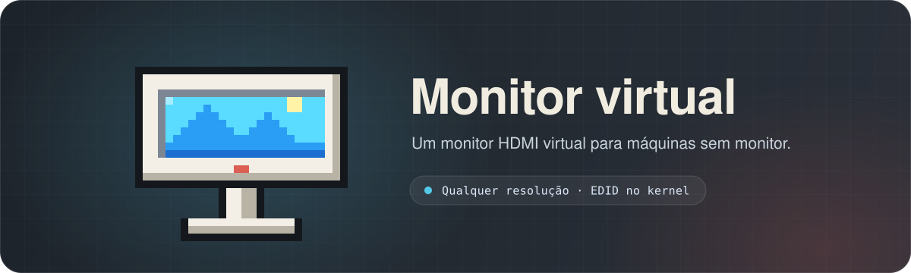
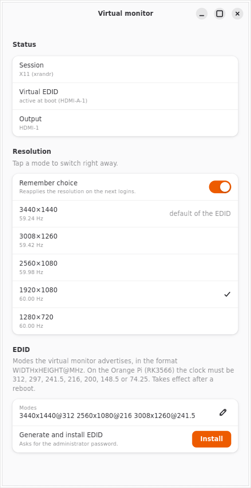

<div align="center">



<br>

<p>
  
  <a href="https://gitlab.com/danie1net0/virtual-hdmi/-/pipelines"></a>
  <a href="https://gitlab.com/danie1net0/virtual-hdmi/-/pipelines"></a>
  <a href="LICENSE"></a>
</p>

<sub><a href="README.md">🇺🇸 English</a> · <b>🇧🇷 Português</b></sub>

<br>



</div>

## Por quê

Máquinas sem monitor (um Orange Pi, um servidor, um notebook de tampa fechada) entregam às
ferramentas de área de trabalho remota, como VNC, RDP ou Jump Desktop, uma tela pequena, ou
nenhuma. O Monitor virtual instala um EDID no kernel, e a saída HDMI passa a agir como um
monitor de verdade, com as resoluções que você escolher. Um app pequeno troca entre elas e
lembra a sua escolha. O EDID do Orange Pi também tem a tela do iPad Air 11" (2360×1640), e o
protocolo Fluid do Jump Desktop pode usá-la quando você conecta pelo tablet.

## Instalar

```sh
sudo apt install python3-gi gir1.2-gtk-4.0 gir1.2-adw-1   # Debian, Ubuntu, Armbian
curl -fsSL https://gitlab.com/danie1net0/virtual-hdmi/-/raw/master/get.sh | bash
```

Isso coloca o **Virtual monitor** no menu de apps, sem sudo. Rode a mesma linha para atualizar;
acrescente `-s -- --uninstall` depois de `bash` para remover, ou `VERSION=v0.3.0` antes de
`bash` para fixar uma versão ([CHANGELOG.md](CHANGELOG.md)). Num clone, `bash install.sh` faz o
mesmo (`--help` lista as opções).

## Usar

Abra o **Virtual monitor** pelo menu e toque num modo. Se você não apertar **Keep** em 15
segundos, o modo anterior volta, então um modo sem imagem se desfaz sozinho. **Scale** e
**Orientation** (retrato, para usar o iPad em pé) ficam salvos para cada resolução. Sem escala
salva, os modos de tablet, como 2360×1640, ficam em 150% e os outros em 100% (no X11, só o XFCE
muda a escala, pelo DPI das fontes).

Ou use o terminal:

```sh
python3 virtual-monitor.py --list                    # saídas e modos
python3 virtual-monitor.py --apply 2560x1080@59.98   # troca e lembra
python3 virtual-monitor.py --apply 1920x1080@60.00 --temp   # só troca
python3 virtual-monitor.py --next                    # próximo modo, para um atalho de teclado
python3 virtual-monitor.py --scale 1.25 --rotation left     # modo atual: 125%, retrato
```

Funciona no GNOME, KDE Plasma, wlroots (sway, Hyprland) e X11 (XFCE, MATE, i3).

## Instalar o EDID

Uma vez por máquina. O app tem um botão **Install** (toque na linha **Virtual EDID**), ou, num clone:

```sh
sudo bash scripts/install-edid.sh edid/ultrawide-rockchip.bin   # Orange Pi (RK3566)
sudo bash scripts/install-edid.sh                               # notebook Intel
```

O script edita o `armbianEnv.txt` ou o GRUB e guarda uma cópia `*.before-edid`. Reinicie depois.

<details>
<summary><b>Gerar o seu próprio EDID</b></summary>

<br>

```sh
python3 -m virtual_monitor.edid saida.bin 3440x1440@312 2560x1600 1920x1200:50 --vic 16
```

Cada modo é `LARGURAxALTURA[@CLOCK_MHZ][:HZ_ALVO]`; `--vic` acrescenta modos CEA padrão. O campo
**Modes** do app aceita o mesmo formato.

No RK3566, use só clocks que o PLL dele gera exatamente (`312`, `297`, `241.5`, `216`, `200`,
`148.5`, `74.25` MHz). Os outros falham com `NOCLOCK`. Um modo sem clock fica com o que chega
mais perto da taxa.

</details>

<details>
<summary><b>Sessão mais leve para servidor sem monitor</b></summary>

<br>

```sh
sudo bash scripts/install-xfce.sh [usuário]   # XFCE + LightDM com login automático
sudo bash scripts/install-session.sh          # impede o GDM de tomar o seat de volta
```

O GNOME continua instalado. Para voltar: `sudo systemctl enable gdm3.service && sudo reboot`.

</details>

## Desenvolver

```sh
bash install.sh --dev     # liga o app a este checkout
bash tests/run.sh         # todos os testes
bash tests/coverage.sh    # exige 100% (no macOS, veja o cabeçalho do script)
```

Só a biblioteca padrão. O CI roda os testes no Python 3.9 e 3.13 e no bash 3.2, o bash do macOS.
Veja o [AGENTS.md](AGENTS.md) para a organização do código e as regras.

## Licença

[MIT](LICENSE). Repositório principal no [GitLab](https://gitlab.com/danie1net0/virtual-hdmi);
o [GitHub](https://github.com/danie1net0/virtual-hdmi) é um espelho.
